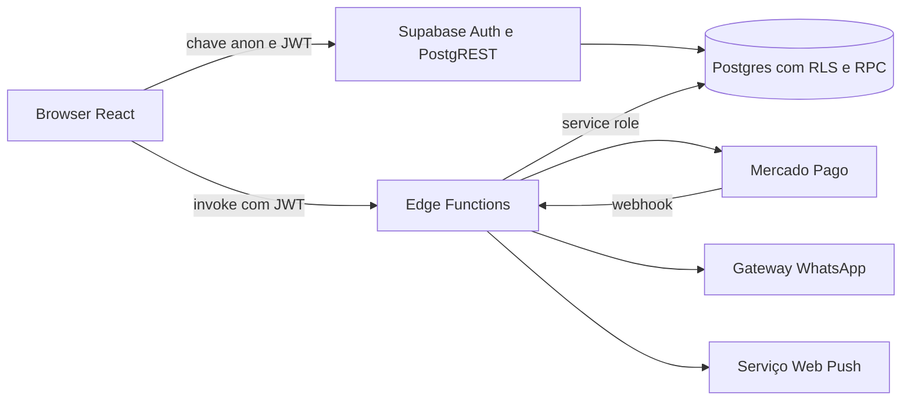
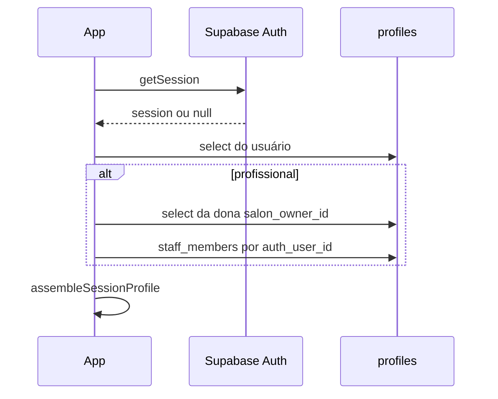
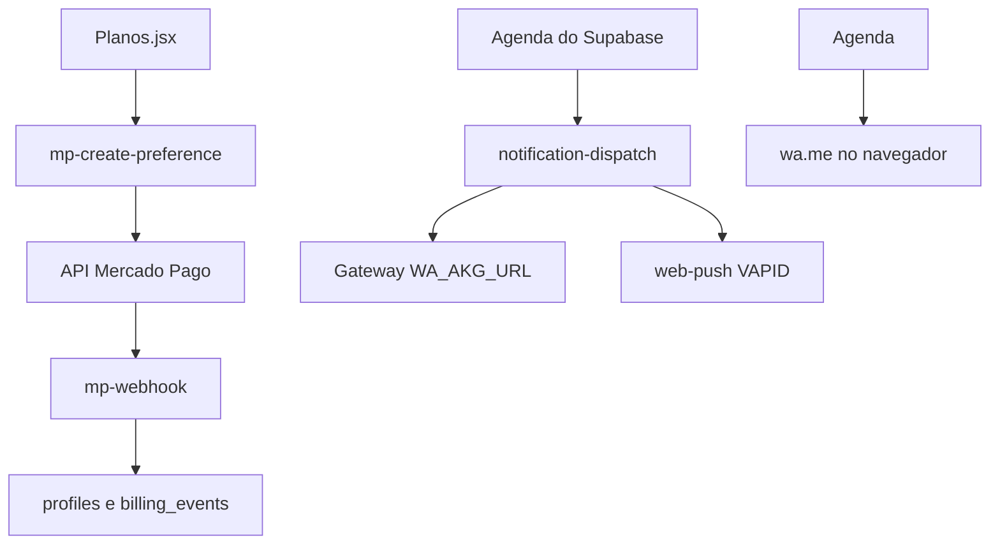

# Arquitetura

Referência: commit `4f7498e`. Produção não foi inspecionada.

## Arquitetura geral

Não há API Node no repositório. `src/supabaseClient.js` cria um cliente com `VITE_SUPABASE_URL` e `VITE_SUPABASE_ANON_KEY`, sessão persistida e fluxo PKCE.

## 1. Inicialização do frontend

`index.html` monta `#root`. `src/main.jsx` renderiza `App` em `StrictMode`. O Vite injeta o service worker pelo plugin em `vite.config.js` (`registerType: 'autoUpdate'`, estratégia `injectManifest`, arquivo `src/sw.js`).

`App` não busca dados de negócio no primeiro render. Só chama `supabase.auth.getSession()` e, se houver usuário, lê `profiles`.

## 2. Roteamento

`BrowserRouter` está dentro de `App`. As rotas públicas ficam fora de `AppLayout`. As rotas logadas ficam num layout com menu. `PlanGate`, filho do layout, pode substituir a página por um redirect para `/planos` ou `/`.

A landing e a Agenda usam o mesmo caminho `/`. A escolha depende de `session` no momento do render. Não há guard por arquivo de rota.

## 3. Sessão

`assembleSessionProfile` (`src/utils/sessionProfile.js`) copia a assinatura da dona para a profissional, força `is_admin: false` e `is_staff: true`, e define `workspace_id` como `salon_owner_id`. UUID no frontend não promove admin. Admin é só `profiles.is_admin === true`.

`onAuthStateChange` recarrega o perfil. Ao voltar para a aba, `visibilitychange` recarrega de novo. Trocar o `user.id` chama `limparCacheFinanceiro()`.

Logout está em `AppLayout`: `supabase.auth.signOut()` e `window.location.assign('/')`.

## 4. Carga e atualização dos dados

Cada página busca o que precisa com `supabase.from` ou `supabase.rpc`. Não há store global além do perfil.

A Agenda lê horários do dia e da semana, lembretes, retornos e lista de espera. Concluir, remarcar e excluir passam por `src/application/appointmentService.js`, que atualiza `appointments` e chama RPCs quando existem.

O Financeiro é o único fluxo com orquestração própria:

1. `decidirSincronizacao` em `financeiroSync.js` vê se deve chamar `sincronizar_financeiro_existente`.
2. A primeira sincronização e a que já passou de 10 minutos não bloqueiam a leitura. Uma alteração suja ou um sync forçado bloqueia.
3. `financeiroLoad.js` dispara as consultas principais em paralelo e as secundárias depois.
4. `financeiroCache.js` guarda o mês por 60 segundos, com geração por salão para ignorar resposta atrasada.
5. A tela monta o livro com `src/domain/financeiro.js`. Se as tabelas da `040` não existirem, `derivarLivro` reconstrói cobranças a partir de `appointments` e `transactions`.

## 5. Onde estão as regras

| Tipo | Onde |
| --- | --- |
| Dinheiro, status e comissão na tela | `src/domain/financeiro.js` |
| Mensalidade ainda derivada de transações | `src/application/mensalidade.js` |
| Conflito de horário no browser | `src/utils/scheduling.js` |
| Conflito de horário no banco | `validar_horario_agendamento` e `marcar_horario_site` |
| Cobrança gravada | `sincronizar_conclusao_atendimento` e `registrar_recebimento` na `040` |
| Plano na navegação | `src/utils/entitlements.js` e `PlanGate` |
| Isolamento da linha | trigger `force_workspace_user_id` e RLS `user_id = workspace_id()` |

Uma regra que existe só no browser pode ser contornada por quem chama a API com o JWT. A regra que importa para dinheiro gravado é a da `040`, e ela só vale se essa migration foi aplicada. O cliente trata a ausência da RPC como “segue sem ela” em `rpcAusente`.

## 6. Comunicação com o Supabase

Leitura e escrita comuns usam PostgREST. O JWT do usuário entra em toda chamada. A chave anon é pública por desenho. Ela não bypassa RLS.

RPCs usadas pelo front incluem, entre outras: `validar_horario_agendamento`, `marcar_horario_site`, `sincronizar_conclusao_atendimento`, `reverter_conclusao_atendimento`, `sincronizar_financeiro_existente`, `registrar_recebimento`, `estornar_recebimento`, `validar_convite`, `consumir_convite_staff`, `enqueue_notification`. A lista exata está nas chamadas `.rpc(` de `src/`.

## 7. Edge Functions

| Função | `verify_jwt` em `supabase/config.toml` | Papel |
| --- | --- | --- |
| `mp-create-preference` | true | Cria a preferência de pagamento com o JWT da dona |
| `mp-webhook` | false | Recebe o Mercado Pago e consulta o pagamento na API oficial |
| `notification-dispatch` | false | Cron da fila. Exige `x-cron-secret` ou service role |
| `push-dispatch` | false | Cron antigo de push. A fila nova também envia push |
| `whatsapp-connect` | false | A função autentica o usuário no código, com o JWT |
| `whatsapp-webhook` | false | Entrada do gateway. Confere `WHATSAPP_WEBHOOK_SECRET` |

`verify_jwt = false` não significa endpoint aberto. O código de cada função recusa a chamada sem o segredo esperado. Isso precisa ser lido na função, não só no `config.toml`.

## 8. Serviços externos

O botão de WhatsApp da Agenda abre `https://wa.me/` no aparelho. Isso não passa pela fila. A fila só envia quando o cron roda e a conexão está `connected`.

## 9. Caches

| Cache | Onde | Duração | Invalidação |
| --- | --- | --- | --- |
| Sessão Supabase | `localStorage` do cliente JS | até o logout ou expiração do refresh token | `signOut` |
| Financeiro | `Map` em memória no `financeiroCache.js` | 60 s (`CACHE_FINANCEIRO_MS`) | `invalidarFinanceiro` e troca de usuário |
| Sync financeiro | `Map` em `financeiroSync.js` | 10 min (`SYNC_FINANCEIRO_MS`) | `marcarFinanceiroSujo` |
| PWA | Workbox em `src/sw.js` | o que o precache do build gravar | `autoUpdate` no próximo carregamento |
| Bundle | `React.lazy` de páginas e gráficos | a sessão da aba | recarregar a página |

Não há Redis nem cache HTTP de API configurado neste repositório.

## 10. Erros e carregamento

- `App` mostra “Carregando...” até a sessão e o perfil.
- Páginas lazy usam `PageFallback`.
- Toasts vêm de `react-hot-toast`, em geral 3 segundos.
- O Financeiro mostra `erroPrincipal` com **Tentar de novo**, `erroSync`, e um aviso específico se a leitura de despesas falhar.
- Se a coluna ou a RPC ainda não existe, vários fluxos tentam de novo sem o campo novo. Exemplos: `deposit_` no agendamento e `package_` no pacote. A mensagem pede para rodar um SQL. Isso é compatibilidade com banco atrasado, não um segundo produto.
- `rpcAusente` engole erro de função inexistente na sincronização da conclusão. A agenda muda de status mesmo se a cobrança da `040` não for gerada.

## Acoplamentos que cruzam arquivos

- Concluir um horário mexe em `appointments`, `clients` (fidelidade e pacote), notificações e, se a `040` existir, `financial_charges` e `commission_entries`.
- O preço do horário fica em `appointments.agreed_price`. Mudar `services.default_price` não reescreve horários antigos.
- A profissional enxerga o plano da dona porque `assembleSessionProfile` espalha a linha da dona e troca o `id`. Um bug nesse espalhamento muda menu e financeiro juntos.
- `transactions` não tem `staff_id`. `financeiroLoad.js` não pede essa coluna. `derivarLivro` ainda lê `transaction.staff_id` se o objeto já trouxer o campo. Pedir a coluna de novo quebra a lista de despesas com HTTP 400. Há teste em `financeiroLoad.test.js`.
