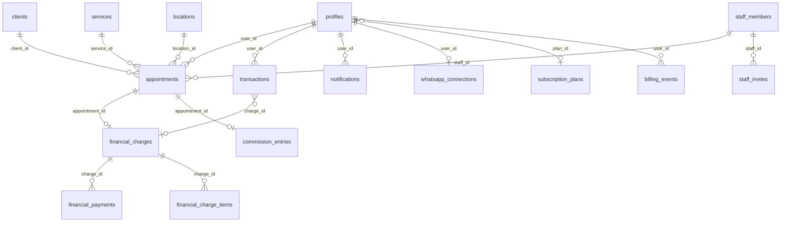

# Banco de dados

Referência: commit `4f7498e`. Este documento descreve o esquema **derivado das migrations** em `supabase/migrations/`. O Postgres de produção não foi consultado. Se uma migration não foi colada no projeto, a tabela ou a função correspondente não existe lá, mesmo estando neste arquivo.

## O que as migrations não criam

A `001_phase1_phase2.sql` começa com `ALTER TABLE` em `services`, `profiles` e `appointments`. A `004` liga RLS em `profiles`, `appointments`, `clients`, `services`, `business_hours` e `transactions`. O `CREATE TABLE` dessas seis relações **não está no repositório**.

Colunas que o código usa e que nenhuma migration deste repo cria (o tipo original fica desconhecido):

| Tabela | Colunas usadas pelo código e não criadas aqui |
| --- | --- |
| `profiles` | `id`, `business_name`, `whatsapp`, `booking_active`, `is_admin`, `is_blocked` |
| `appointments` | `id`, `user_id`, `client_id`, `service_id`, `start_time`, `status`, `agreed_price`, `payment_method` |
| `clients` | `id`, `user_id`, `name`, `phone`, `type` |
| `services` | `id`, `user_id`, `name`, `default_price` |
| `business_hours` | `user_id`, `day_of_week`, `open_time`, `close_time`, `is_closed` |
| `transactions` | `id`, `user_id`, `type`, `amount`, `date`, `description`, `client_id` |

A `020` mostra que `appointments.id` e `appointments.service_id` já passaram por incompatibilidade de tipo. A função vigente trata `appointments.id` como `bigint` e `clients.id` como o tipo que o `DO` da `040` descobre em tempo de execução (`client_type`). Não assuma uuid em `appointments.id`.

## Ordem e numeração

O Supabase CLI ordena pelo nome do arquivo. Há dois arquivos `029`:

1. `029_mp_billing_idempotency.sql`
2. `029_workspace_followup_portfolio.sql`

O README manda aplicar os dois, nessa ordem. Um histórico que guarde só o número `029` pode marcar o segundo como já aplicado. Pendência: conferir `supabase_migrations.schema_migrations` no projeto real.

O README, na revisão anterior a este documento, parava na `039`. Também existem:

- `040_financeiro_recebimentos.sql` — cobranças, pagamentos, comissões, auditoria e RPCs.
- `041_financeiro_indices.sql` — quatro índices. Não muda regra.
- `042_fidelidade_mensagens_financeiro.sql` — fidelidade desligada por padrão, `clients.bot_messages_enabled`, e correção de mensalidade / “ainda não recebi”. Substitui funções da `035` e da `040`; não edita esses arquivos.

Migrations com o mesmo assunto reescrito várias vezes: `validar_horario_agendamento`, `marcar_horario_site`, `solicitar_horario_publico`, `criar_agendamento_publico`, `sync_appointment_notifications`, `enqueue_notification`. Vale a **última definição na ordem dos arquivos**, se todas tiverem sido aplicadas. A versão atual de `marcar_horario_site` está na `036`.

## Diagrama das relações criadas ou alteradas aqui

As tabelas da base aparecem porque as migrations penduram chave nelas. Cardinalidade simplificada.

## Tabelas criadas nas migrations

### `blocked_slots` (`001`)

`id uuid` PK, `user_id` FK `auth.users`, `start_time`, `end_time`, `reason`, `created_at`. Índice `(user_id, start_time)`.

### Fase 3 e 4 (`002`)

| Tabela | Colunas principais |
| --- | --- |
| `financial_goals` | `user_id` único, `monthly_target numeric(10,2)`, `created_at` |
| `subscription_plans` | `id`, `name`, `price`, `features jsonb`, `active`. A `027` acrescenta preço e intervalo. A `028` acrescenta plano anual |
| `push_subscriptions` | `user_id`, `endpoint`, `p256dh`, `auth`, `user_agent` |
| `loyalty_settings` | `user_id`, `visits_required`, `reward_description`, `active` |
| `coupons` | `code`, `discount_type`, `discount_value`, `max_uses`, `uses_count`, `active`, `user_id` |
| `inventory_items` | `name`, `quantity`, `unit`, `min_quantity`, `user_id`. A `003` acrescenta `sale_price numeric(10,2)` |
| `locations` | `name`, `address`, `is_default`, `user_id` |
| `staff_members` | `name`, `phone`, `commission_percent`, `location_id`, `auth_user_id`, `active`, `user_id` |

### Convites e cobrança do software (`005`, `014`, `015`)

`invites`: token, e-mail, `expires_at` (padrão 14 dias na `005`), `used_at`, `created_by`. `billing_events`: `mp_payment_id`, status, efeito aplicado, `user_id`, `plan_id`. A `029_mp` reforça idempotência e índice `(user_id, last_seen_at desc)`.

`app_settings` (`010`): linha de configuração, inclusive o antigo código de admin. A `037` faz `ativar_admin_com_codigo` sempre devolver `ok: false`.

### Operação (`009`)

`waitlist`: nome, telefone, serviço, data preferida, status, `user_id`. Índice `(user_id, status)`.

`staff_invites`: token, `staff_id`, e-mail, uso.

### Perfil público (`027`, `028`)

`portfolio_photos`: `user_id`, URL, legenda, `created_at`. Índice `(user_id, created_at desc)`.

`followup_reminders`: cliente, data `remind_on`, `sent_at`. Índice parcial dos não enviados.

### Notificações (`030`–`034`, `036`)

`notifications`: canal, tipo, `scheduled_for`, `next_attempt_at`, status, tentativas, `payload`, `user_id`, `client_id`, `appointment_id`.

`whatsapp_connections`: sessão, status, `user_id`.

`whatsapp_inbound`: mensagem recebida. Índice único de mensagem na `034`.

`assistant_sessions`: estado da conversa automática.

`notification_attempts`: histórico de tentativa.

`public_booking_hits`: telefone e salão para o limite da `036`.

`admin_platform_invites` (`037`): convite de admin, 2 dias, uso único.

### Financeiro gravado (`040`)

`financial_charges`: `kind` em `ATENDIMENTO`, `MENSALIDADE`, `VENDA`, `MANUAL`. `appointment_id bigint` único. `original_amount` e `discount_amount` não negativos. `status` em `PENDENTE`, `PARCIAL`, `PAGO`, `ESTORNADO`, `CANCELADO`. `source_key` único por `user_id`.

`financial_charge_items`: itens da mensalidade, um `appointment_id` único.

`financial_payments`: valor positivo, `entry_type` `RECEBIMENTO` ou `ESTORNO`, `idempotency_key` único por usuário, `reversal_of` único.

`commission_entries`: um por `appointment_id`. `percent_applied`, `base_amount`, `amount_due`. Status `PENDENTE`, `PAGO`, `CANCELADO`. Trigger impede mudar base, percentual e valor depois de gravados.

`financial_audit_log`: antes e depois em jsonb. Trigger nas três tabelas anteriores.

`transactions` ganha `charge_id`, `payment_id` e `commission_entry_id`. Índice único de idempotência por usuário. Trigger bloqueia delete de transação vinculada a pagamento.

A `003` já tinha acrescentado em `transactions`: `category`, `payment_method`, `inventory_item_id`, `quantity`. Não existe coluna `staff_id` nessa tabela nas migrations. O código deixou de pedi-la de propósito.

## Colunas acrescentadas nas tabelas antigas

| Tabela | Acréscimos verificados |
| --- | --- |
| `profiles` | bio, endereço, Instagram, perfil público, lembretes, plano, trial de 14 dias, `salon_owner_id`, `onboarding_done`, `last_seen_at`, capa, logo, `auto_confirm_public`, `ai_enabled`, `deposit_mode`, `deposit_value`, `pix_key` |
| `appointments` | lembrete enviado, cupom, desconto, profissional, unidade, motivo de cancelamento, push enviado, `deposit_amount`, `deposit_status` (`none`, `pending`, `paid`, `applied`) |
| `clients` | fidelidade, mensalidade (`monthly_fee`, dia e offset), pacote (`package_size`, `package_used`), aniversário |
| `services` | `duration_minutes` padrão 60, `maintenance_days` nulo ou 15, 21 ou 30 |
| `business_hours` | `break_start`, `break_end` |

`deposit_mode` aceita os valores que a constraint da `039` gravar. O front usa `off`, `percent` e `fixed` (`src/utils/deposit.js`).

## Funções SQL que o sistema usa

Isolamento: `workspace_id()`, `my_salon_owner_id()`, `current_user_is_admin()`, `force_workspace_user_id()`.

Agenda pública: `get_agenda_publica`, `get_perfil_publico`, `get_resumo_agendamento`, `marcar_horario_site`, `limite_pedido_publico`, `entrar_lista_espera`, `validar_horario_agendamento`, `validar_cupom`.

Conta: `validar_convite`, `criar_convite`, `consumir_convite`, `criar_convite_staff`, `validar_convite_staff`, `consumir_convite_staff`, `criar_convite_admin`, `ativar_admin_com_convite`, `bootstrap_primeiro_admin`. `ativar_admin_com_codigo` existe e recusa.

Financeiro (`040`): `registrar_recebimento`, `estornar_recebimento`, `cancelar_cobranca`, `quitar_comissao`, `definir_desconto_cobranca`, `sincronizar_conclusao_atendimento`, `reverter_conclusao_atendimento`, `sincronizar_financeiro_existente`, `recalcular_status_cobranca`.

Fila: `enqueue_notification`, `sync_appointment_notifications`, `claim_due_notifications`, `notify_waitlist`, `admin_fila_saude`.

Assistente: `assistente_cancelar`, `assistente_remarcar`.

Fidelidade: `incrementar_fidelidade` ainda existe na `008`, mas `src/utils/loyalty.js` **não chama** essa RPC. Soma `loyalty_visits` com `update`.

## RLS e isolamento

A partir da `009`, as políticas das tabelas de salão são `FOR ALL` com `user_id = public.workspace_id()`.

`workspace_id()` devolve `profiles.salon_owner_id` da pessoa logada, ou o próprio `auth.uid()` se ela for a dona.

A trigger da `037` reescreve `NEW.user_id` para esse workspace em insert e update, nas tabelas listadas no arquivo. `service_role` e sessão sem `auth.uid()` (SQL Editor) não são reescritos.

Profissional e dona passam na mesma política, porque as duas resolvem para o mesmo `user_id`. A diferença de menu é só no frontend.

`subscription_plans` tem select liberado (`plans_read_all`).

`financial_audit_log` é leitura do próprio workspace. Escrita vem da trigger, não do browser.

Políticas de storage do portfólio estão na `027` e são refeitas na `029_workspace` e na `037`.

## Quem usa cada grupo de tabelas

| Tabelas | Leitura e escrita |
| --- | --- |
| `appointments`, `clients`, `services`, `business_hours`, `blocked_slots` | Agenda, novo horário, configurações, RPCs públicas |
| `transactions`, `financial_*`, `commission_entries` | Financeiro e a conclusão |
| `staff_members`, `locations`, `staff_invites` | Equipe e o filtro da agenda |
| `inventory_items` | Estoque e venda no financeiro |
| `coupons`, `loyalty_settings` | Fidelidade, novo horário, agenda pública |
| `notifications`, `whatsapp_*`, `push_subscriptions` | Configurações e Edge Functions |
| `profiles`, `subscription_plans`, `billing_events`, `invites` | Sessão, planos, admin |
| `waitlist`, `followup_reminders`, `portfolio_photos` | Agenda, perfil público, configurações |

## Índices da `041`

- `appointments (user_id, start_time)`
- `appointments (client_id, start_time)` onde `status = 'CONCLUIDO'`
- `transactions (user_id, date)`
- `transactions (user_id)` onde `type = 'RECEITA'` e `charge_id` é nulo

O arquivo avisa para rodar depois de backup. `EXPLAIN` em produção não foi executado.

## Como criar uma migration nova

1. Não edite um arquivo já aplicado em produção. O README e o histórico deste projeto tratam SQL aplicado como imutável.
2. Crie `supabase/migrations/042_descricao_curta.sql` com o próximo número livre. Não reutilize `029`.
3. Use `IF NOT EXISTS` e `CREATE OR REPLACE` só quando a mudança for compatível com quem já rodou o arquivo anterior.
4. Se a política ou a função mudar, derrube a versão antiga pelo nome exato. Políticas com aspas e sem aspas são nomes diferentes.
5. Aplique primeiro num projeto Supabase de teste. Backup antes do projeto real.
6. O front na Vercel não executa SQL.
7. Se a tela precisar da coluna nova, trate a ausência como o agendamento faz com `deposit_`, ou exija a migration de forma explícita. Não peça `staff_id` em `transactions`.

## Pendências de validação

- Lista completa de colunas originais de `profiles`, `appointments`, `clients`, `services`, `business_hours` e `transactions`.
- Quais das 42 migrations estão de fato em `schema_migrations`, em especial as duas `029`, a `040` e a `041`.
- Se a policy `"blocked_slots_public_read"` da `001` (`USING (true)`) ainda existe. Nenhuma migration posterior dá `DROP` nela. Ver [Problemas conhecidos](11-problemas-conhecidos.md).
