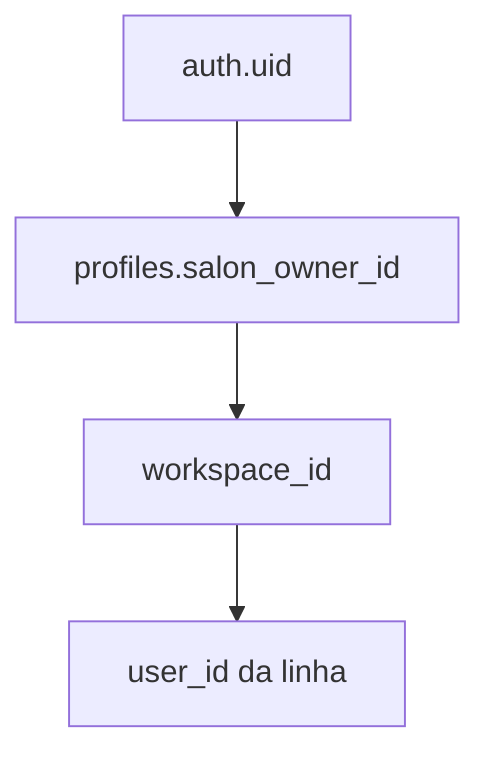

# Autenticação, autorização e permissões

Referência: commit `4f7498e`. O efeito das policies no banco real não foi consultado com um cliente logado. O que segue é o que o código e o SQL fazem.

## Login, logout e sessão

`src/pages/Login.jsx` chama `supabase.auth.signInWithPassword`. Erro vira toast `Erro: ` mais a mensagem do Auth, em inglês, como o Supabase devolve.

`src/pages/EsqueciSenha.jsx` chama `resetPasswordForEmail` com redirecionamento para `publicAppUrl()/redefinir-senha`. O template está em `supabase/templates/recovery.html`. `src/pages/RedefinirSenha.jsx` conclui a troca.

O cliente em `src/supabaseClient.js` usa `flowType: 'pkce'`, `persistSession: true` e `detectSessionInUrl: true`. O token fica no storage do browser. Não há tabela de sessão da aplicação.

Logout: botão **Sair** em `src/components/AppLayout.jsx`, com confirmação, `signOut` e redirect para `/`.

Conta bloqueada (`is_blocked`) mostra `src/pages/Bloqueado.jsx` e não monta as rotas.

## Cadastro

Não há cadastro aberto. `/cadastro-vip` sem `token` mostra que o convite é obrigatório (`src/pages/Cadastro.jsx`).

Com token, a página tenta `validar_convite_staff`. Se falhar, tenta `validar_convite`. Os dois preenchem o e-mail quando a RPC devolve. A senha precisa de 6 caracteres. O `signUp` manda `invite_token` no metadata. Staff ainda chama `consumir_convite_staff`. Dona chama `consumir_convite`.

Convite de dona nasce no Admin (`criar_convite`). Convite de profissional nasce em Equipe (`criar_convite_staff`). Convite de admin da plataforma nasce com `criar_convite_admin` e é consumido por `ativar_admin_com_convite`. Não é o plano Pro.

## Perfis

| Perfil | Como o código reconhece | Workspace |
| --- | --- | --- |
| Dona | `profiles` sem `salon_owner_id` | o próprio `auth.uid()` |
| Profissional | `salon_owner_id` preenchido | o id da dona. `is_admin` é forçado para falso |
| Admin da plataforma | `is_admin === true` na própria linha | o próprio id, e o menu ganha Admin |
| Visitante | sem JWT | só RPCs `SECURITY DEFINER` pensadas para o site |

`src/utils/sessionProfile.js` é a única montagem do perfil. Testes em `src/utils/sessionProfile.test.js` cobrem que UUID solto não vira admin.

A profissional herda plano, trial e bloqueio da dona. O bloqueio dela também vale se a própria linha estiver bloqueada.

## Matriz de permissões

“Tela” é o que o React deixa abrir. “Banco” é o que a RLS e as RPCs permitem para o JWT. O plano não é revalidado no Postgres.

| Operação | Dona com plano válido | Dona com plano vencido | Profissional | Admin da plataforma | Visitante |
| --- | --- | --- | --- | --- | --- |
| Agenda, clientes, serviços, financeiro | tela e banco do próprio workspace | banco sim, tela redireciona para Planos. Configurações e Planos continuam | tela e banco do workspace da dona | tela, se a conta também for um salão | não |
| Estoque, fidelidade, equipe | só se `subscription_plans.features` contiver o nome | não na tela | igual à dona, exceto Equipe, que a tela esconde | `hasFeature` ignora o plano | não |
| Configurações, Planos | sim | sim | não. `PlanGate` manda para `/` | sim | não |
| Admin | não | não | não | sim | não |
| Excluir horário, concluir, lançar despesa | a dona lança despesa. A profissional não vê **Lançamento manual** nem a aba Relatórios | a tela nem abre | concluir horário sim. Despesa manual não | conforme a conta | não |
| Pedir horário no link | — | — | — | — | RPC `marcar_horario_site` |
| Ler clientes ou financeiro direto | RLS do workspace | RLS do workspace | RLS do mesmo workspace | RLS do próprio workspace, não do salão alheio | não, se a `004` e a `009` foram aplicadas |
| Virar admin com código mestre | a RPC da `037` recusa | recusa | recusa | já é admin | recusa |

`BASIC_FEATURES` em `src/utils/entitlements.js` é `Agenda`, `Clientes` e `Financeiro`. Serviços não está em `FEATURE_BY_PATH`, então qualquer assinatura utilizável abre `/servicos`. O README antigo dizia que o teste incluía Serviços como item de plano. Na prática Serviços não é um feature flag.

Plano utilizável (`isSubscriptionUsable`): admin sempre. `active` enquanto `subscription_expires_at` não passou. `trial` enquanto `trial_ends_at` ou `subscription_expires_at` não passou. Outro status não abre os módulos pagos. A duração de 14 dias está na `005`, não no React.

## Proteção de rotas

Há três camadas, todas no cliente, mais o RLS:

1. Sem `session`, as rotas internas não são registradas.
2. `AppLayout` tira Equipe, Planos e Configurações do menu da profissional e esconde itens sem feature.
3. `PlanGate` redireciona URL digitada na mão.

Digitar `/admin` sem `is_admin` volta para `/`. Digitar `/estoque` sem a feature, com plano válido, volta para `/planos`.

Isso não impede `supabase.from('inventory_items').select()` no console se a RLS deixar o workspace ler a tabela. A RLS da `009` deixa.

## Convites e vínculo

`consumir_convite_staff` grava `profiles.salon_owner_id` e liga `staff_members.auth_user_id`. A `012` limpa vínculo de staff quando alguém vira outro tipo de conta. A ordem exata está na função da `037`, que substitui a versão anterior.

Onboarding só aparece para dona com `onboarding_done === false`. A profissional nasce com `onboarding_done: true` no perfil montado.

## Isolamento

Frontend: `workspaceId(profile, authUserId)` usa `workspace_id`, depois `salon_owner_id`, depois o uid.

Banco: a função homônima só olha `salon_owner_id`. Os dois precisam concordar. O perfil montado grava `workspace_id` igual a `salon_owner_id`.

A trigger `trg_workspace_user` impede a profissional de gravar `user_id` com o próprio auth id. Tudo vai para o salão.

SQL Editor e service role não passam por essa troca. Edge Functions que usam service role podem ler qualquer salão. Elas precisam filtrar pelo id que a regra de negócio escolheu.

## O que é só frontend e o que o banco aplica

| Controle | Frontend | Banco |
| --- | --- | --- |
| Senha e JWT | tela de login | Supabase Auth |
| Admin | esconde menu | `is_admin` e policies de admin. Código mestre desligado na `037` |
| Plano Pro | menu e `PlanGate` | não há policy por feature |
| Profissional sem Configurações | menu e redirect | a profissional ainda passa na RLS do workspace, inclusive `profiles` da dona se a policy permitir o select usado em `loadProfile` |
| Horário ocupado | `scheduling.js` | `validar_horario_agendamento` e o lock em `marcar_horario_site` |
| Dinheiro da conclusão | a tela escolhe o método | `sincronizar_conclusao_atendimento`, se a `040` existir |
| Cupom ativo público | — | a policy `coupons_public_read` é removida na `037` |

A policy vigente no SQL da `013`, não substituída pela `037`, é `profiles_select_own_or_admin`. O `USING` permite a própria linha, admin, `id = my_salon_owner_id()` e `salon_owner_id = auth.uid()`. Com essa policy aplicada, a profissional lê a linha da dona e a dona lê as linhas da equipe. Se a `013` não foi colada no projeto, o `loadProfile` cai no select menor e a profissional fica sem o plano da dona.
